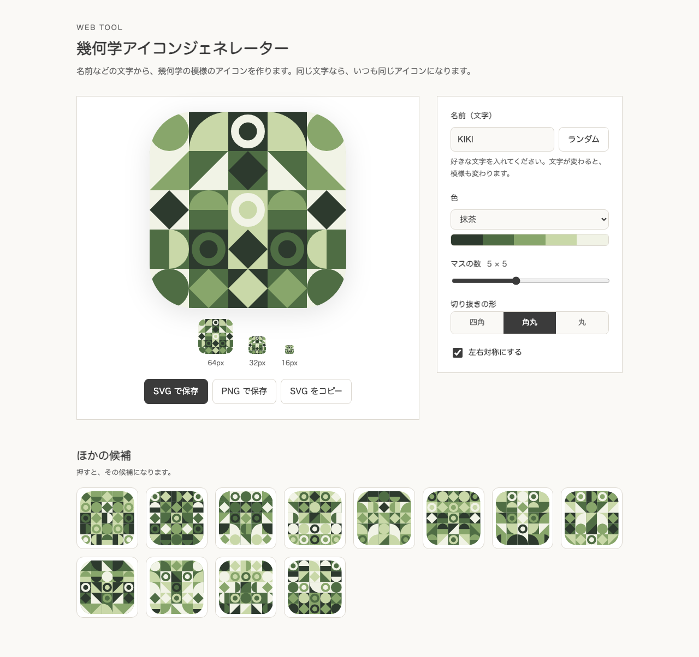

# 幾何学アイコンジェネレーター（Geometric Icon Generator）

名前などの文字から、幾何学の模様のアイコンを作る Web ツールです。
**同じ文字からは、いつも同じアイコン**ができます。ブログやポートフォリオのプロフィール画像、ファビコンに使えます。
Vite + TypeScript で作っていて、ライブラリは使っていません（実行時の依存はゼロです）。



## できること

- 名前（文字）から、模様を自動で作る。「ランダム」ボタンと、12 個の候補つき
- 色のパレット 5 種類、マスの数（3〜8）、切り抜きの形（四角・角丸・丸）、左右対称の切りかえ
- 64px / 32px / 16px に小さくしたときの見え方を、その場で確認できる
- **SVG・PNG で保存**、SVG のコードをコピー

## 動かし方

```bash
npm install
npm run dev        # 開発用サーバー（http://localhost:5173）
npm test           # テスト
npm run typecheck  # 型のチェック
npm run build      # 公開用のファイルを dist/ に作る
```

## 仕組み

SVG は、図形を**文字で書いた画像**です。このツールは、その文字を計算で組み立てているだけです。

```
名前（文字）
   ↓ ① 文字を数に変える（hashString）
   ↓ ② その数から、決まった順番の乱数を作る（createRandom）
   ↓ ③ 乱数で、マスごとに「図形・向き・色」を決める（designCells）
   ↓ ④ 各マスを SVG の部品にして、つなぎ合わせる（generateIcon）
SVG の文字列 → 画面に表示 / ファイルに保存
```

- **同じ文字なら同じ絵になる理由:** 乱数を「seed（種）」から作っているからです。種が同じなら、出てくる数の並びも同じになります（`src/random.ts`）。
- **図形は 6 種類:** 円・4 分の円・半円・三角・ひし形・輪っか。それぞれ、マスの中の座標を計算して描きます（`src/generate.ts` の `shapeMarkup`）。
- **左右対称:** 左半分だけ作り、右半分は、同じマスを**横に反転**して置きます（`scale(-1 1)`）。
- **PNG の作り方:** SVG を画像として読みこみ、`canvas` に描いて、PNG として取り出します（`src/main.ts` の `svgToPng`）。

## 安全のための工夫

SVG は文字でできているので、変な文字を入れられると、`<script>` などを混ぜられるおそれがあります。

- SVG に入れる**色は、`#RRGGBB` などの形かを、先にチェック**します（`isHexColor`）。ちがう形はエラーにします。
- 入力した名前は、**SVG の中には入れません**（乱数の種にだけ使う）。クリップの名前も、設定から計算した値です。
- この 2 点を、テストで確かめています（`test/generate.test.ts`）。

## TypeScript で使っている機能

| 機能 | 使っている場所 | ひとこと |
| --- | --- | --- |
| **型（interface）** | `IconOptions`, `State`, `Palette` | 「こういう形のデータ」という約束。足りない項目や、まちがった種類を、動かす前に教えてくれる |
| **ユニオン型** | `ShapeKind`, `Mask` | `'circle' \| 'quarter' …` のように、決まった文字のどれかだけを許す。打ちまちがいを防ぐ |
| **readonly** | `colors: readonly string[]` | あとから書きかえられない配列。パレットを、うっかり壊さない |
| **ジェネリクス** | `must<T extends HTMLElement>` | 「この部品は input だよ」と呼ぶときに伝えると、`.value` などの専用の機能が使える |
| **型ガード** | `isMask(value): value is Mask` | 調べた結果を、TypeScript に教える。`true` のあとは、その値を `Mask` として扱える |
| **厳しい設定** | `strict`, `noUncheckedIndexedAccess` | 配列の `[0]` は「ないかもしれない」型になり、`undefined` の見落としを防ぐ |

## ファイル

| ファイル | 内容 |
| --- | --- |
| `src/random.ts` | 文字 → 数 → 乱数 |
| `src/palettes.ts` | 色のパレットと、色の書き方のチェック |
| `src/generate.ts` | アイコン（SVG の文字列）を作る中心の部分。画面には触らない |
| `src/main.ts` | 画面の動き（入力・表示・保存・コピー） |
| `src/style.css` | 見た目 |
| `test/generate.test.ts` | テスト（16 個） |

## 作った人

KIKI — ポートフォリオ：https://kiki-portfolio.kiki-works.workers.dev/
